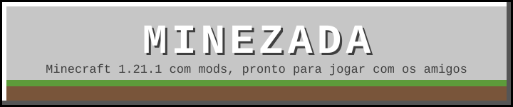

<p align="center">
  
</p>

<p align="center">
  <a href="https://github.com/EnzoFerroni/minezada/blob/status/status.json"></a>
  <a href="https://enzoferroni.github.io/minezada/"></a>
  <a href="https://enzoferroni.github.io/minezada/mods.html"></a>
</p>

<p align="center">
  O selo verde diz se o servidor está ligado agora. A <a href="https://enzoferroni.github.io/minezada/">página</a> mostra o mapa, quem está online e as conquistas.
</p>

## Como jogar em 3 passos

| | O que fazer |
|:-:|---|
| **1** | **Abra o programa de comandos do seu computador.** No **Windows**, aperte a tecla do Windows, digite `PowerShell` e abra. No **Mac**, aperte `Cmd + Espaço`, digite `Terminal` e abra. |
| **2** | **Copie o comando do seu sistema** (logo abaixo), cole na janela que abriu e aperte **Enter**. Ele instala tudo sozinho. |
| **3** | **Responda as perguntas** que aparecerem (se tem Minecraft original e se quer o atalho; diga que **sim** ao atalho). O jogo abre no fim. |

**Windows** (no PowerShell):

```powershell
irm https://raw.githubusercontent.com/EnzoFerroni/minezada/main/jogar.ps1 | iex
```

**Mac** ou **Linux** (no Terminal; no Linux ainda não foi testado em um computador de verdade):

```sh
curl -fsSL https://raw.githubusercontent.com/EnzoFerroni/minezada/main/jogar.sh | bash
```

> Dica: para copiar, passe o mouse sobre o comando e clique no botão de copiar que aparece no canto direito.

Na primeira vez, o jogo pede a sua conta. **Tem Minecraft original?** Entre com a conta Microsoft. **Não tem?** Escolha um nick (o mesmo que você mandou para quem cuida do servidor). Depois espere os mods baixarem; da primeira vez demora alguns minutos.

## Depois de instalado

1. Abra sempre pelo atalho **Minezada** na Área de Trabalho. Ele atualiza tudo sozinho a cada abertura.
2. No menu do jogo, clique em **Multijogador** e entre em **Minezada**.
3. Perdido? Abra o **livro de missões** pelo botão no inventário: ele ensina o pack passo a passo.
4. Medo de água-viva? Ligue o pacote **modo-patinho** em Opções → Pacotes de recursos: elas viram patinhos de borracha e bolinhas felizes.

## Deu problema?

| O que aconteceu | O que fazer |
|---|---|
| Qualquer erro na instalação | Rode o comando de novo. Ele conserta e não apaga nada. |
| "You are not white-listed" | Mande o seu nick exato (com as maiúsculas) para quem cuida do servidor. |
| Pede senha (só quem não tem original) | Na primeira vez escolha uma senha e digite `/register senha senha`. Nas próximas, `/login senha`. |
| Jogo lento | **Opções** > **Perfis** > **1 - Minimo**. Os perfis vão de 1 (mais leve) a 7 (mais bonito). |
| O jogo fechou ou não conecta | Rode o comando de enviar os registros (abaixo) e mande os links que ele mostra para quem cuida do servidor. |

<details>
<summary><b>Comando de enviar os registros do jogo</b></summary>

Ele manda os registros do jogo para o site [mclo.gs](https://mclo.gs) e copia os links. Vai só o seu nick, nada pessoal.

**Windows** (no PowerShell):

```powershell
irm https://raw.githubusercontent.com/EnzoFerroni/minezada/main/logs.ps1 | iex
```

**Mac** ou **Linux** (no Terminal):

```sh
curl -fsSL https://raw.githubusercontent.com/EnzoFerroni/minezada/main/logs.sh | bash
```

</details>

<details>
<summary><b>Desinstalar</b></summary>

Remove a Minezada, o atalho e o launcher (o Prism só sai se não tiver outras instâncias). Pergunta antes de apagar.

**Windows** (no PowerShell):

```powershell
irm https://raw.githubusercontent.com/EnzoFerroni/minezada/main/desinstalar.ps1 | iex
```

**Mac** ou **Linux** (no Terminal):

```sh
curl -fsSL https://raw.githubusercontent.com/EnzoFerroni/minezada/main/desinstalar.sh | bash
```

</details>

<details>
<summary><b>Usar outro launcher (Modrinth App, ATLauncher)</b></summary>

Cada [versão](https://github.com/EnzoFerroni/minezada/releases/latest) traz o arquivo `.mrpack` para importar. Por ele o pack não se atualiza sozinho. O Distant Horizons é opcional: no Mac, deixe desligado.

</details>

## Quer ajudar?

- **Ideia, mod ou problema?** Abra uma [issue](https://github.com/EnzoFerroni/minezada/issues/new/choose) (é como um recado público para o projeto).
- **Quer mexer no pack ou no código?** O [guia](.github/CONTRIBUTING.md) explica como montar e testar.
- **Vai hospedar o servidor?** Veja [Hospedar](docs/hospedar.md).

<sub>[Mods](docs/mods.md) · [Hospedar](docs/hospedar.md) · [Tarefas](https://github.com/users/EnzoFerroni/projects/3) · [Versões](https://github.com/EnzoFerroni/minezada/releases) · [Decisões](docs/decisoes.md) · [Como mexer](.github/CONTRIBUTING.md)</sub>

<sub>Código e documentação sob a [licença MIT](LICENSE). Os mods não ficam neste repositório: o jogo baixa cada um do Modrinth ou do CurseForge (só os que o autor libera), com a licença de cada autor. O zip do Prism traz o [packwiz-installer](https://github.com/packwiz/packwiz-installer) (MIT).</sub>
